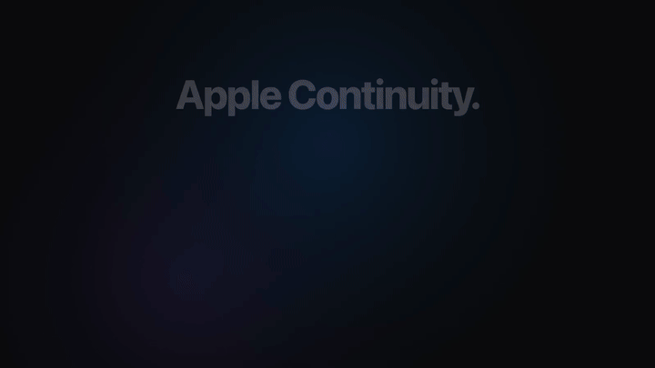
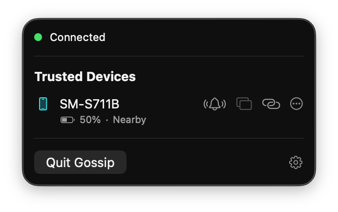
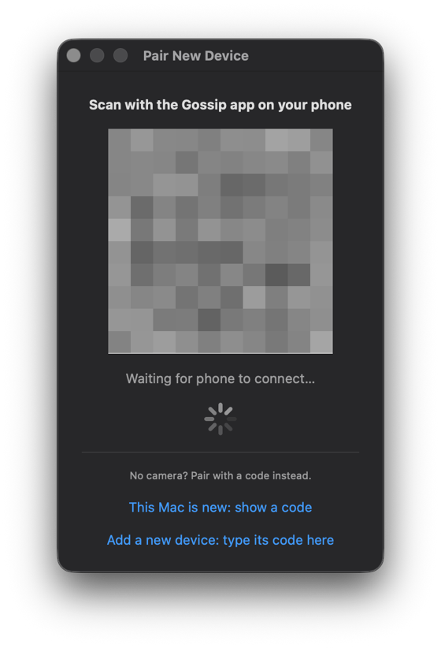
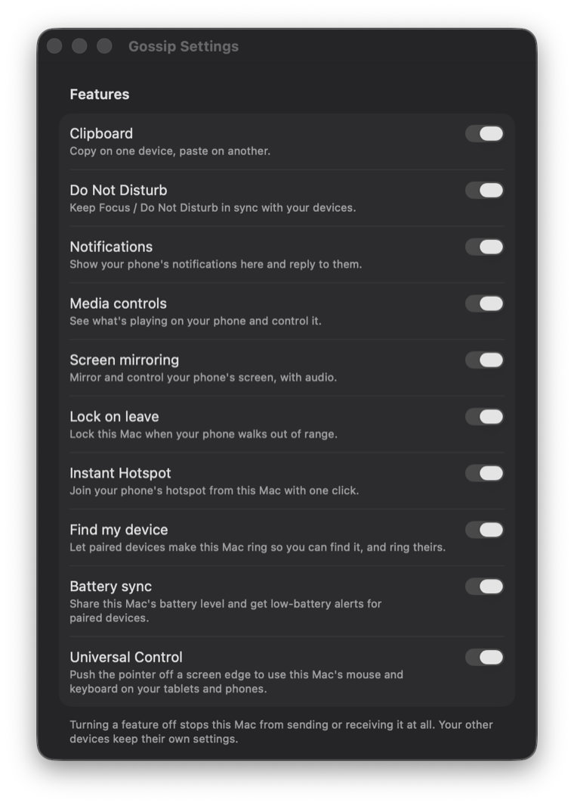
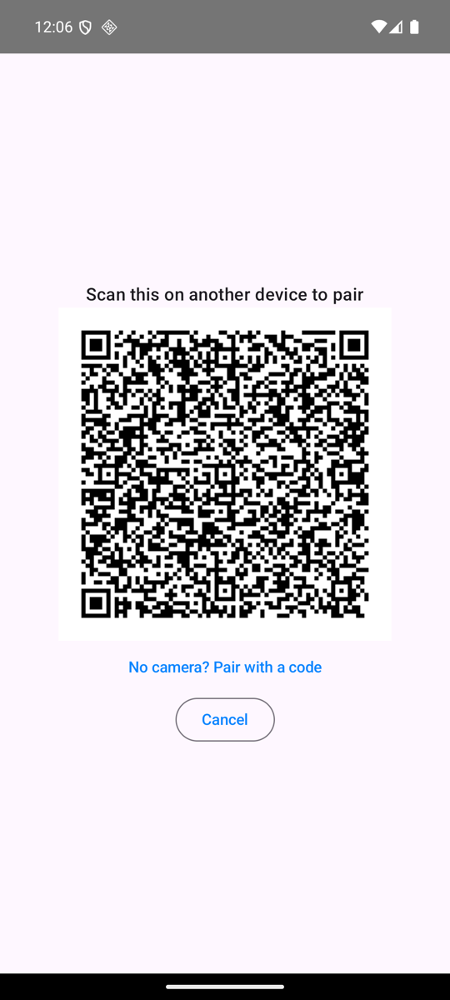
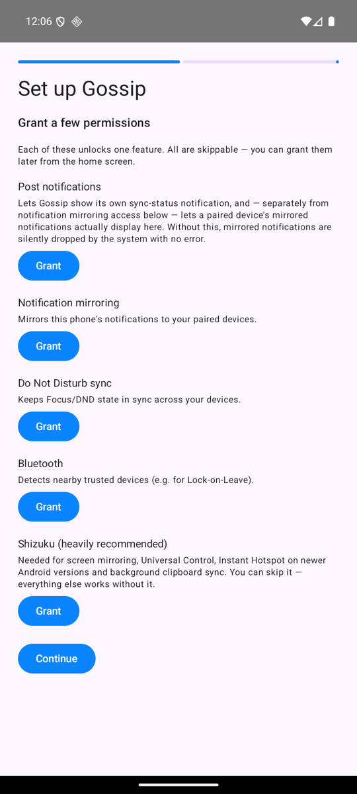
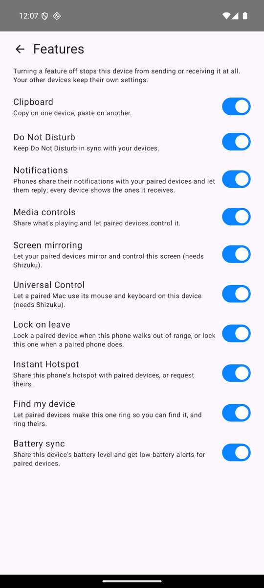
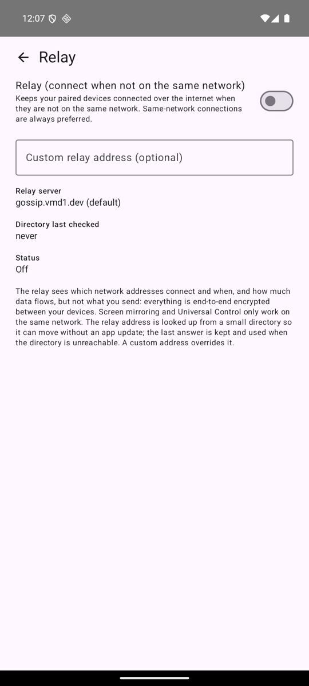

# Gossip

**Your Mac and your Android devices, working as one.**

Notifications, clipboard, Do Not Disturb, media, screen mirroring and Universal Control between a Mac and Android phones and tablets.
Direct on your local network, optionally relayed (end-to-end encrypted) when you're away. No account.

[**Download**](https://github.com/vmd1/gossip/releases/latest) · [Website](https://gossip.vmd1.dev) · [Getting started](docs/getting-started.md) · [FAQ](docs/faq.md) · [Roadmap](ROADMAP.md)

 Watch with sound: <a href="site/video/gossip.mp4">gossip.mp4</a>

---

## Features

| | Feature | What it does |
|---|---|---|
| 🖱️ | **Universal Control** | Push the Mac's cursor off a screen edge and keep going on your phone or tablet, with the Mac's mouse and keyboard. *Needs Shizuku.* |
| 📱 | **Screen mirroring** | Mirror and control an Android screen from the Mac, with audio. *Needs Shizuku.* |
| 🔔 | **Notification mirroring** | See phone notifications on the Mac, reply inline, dismiss in sync. |
| 📋 | **Clipboard sync** | Copy on one device, paste on another: text and images. |
| 🌙 | **Do Not Disturb / Focus sync** | Turn it on in one place and it follows everywhere. |
| ▶️ | **Media remote** | See what's playing and control playback on any device. |
| 📶 | **Instant Hotspot** | Turn on your phone's hotspot from the Mac and join it automatically. *Android 16+ needs Shizuku.* |
| 🔒 | **Lock on leave** | Lock a Mac or tablet when your phone walks out of Bluetooth range. |
| 📍 | **Find my device** | Make a paired device ring at full volume. |
| 🔋 | **Battery sync** | See every device's battery, with low-battery alerts. |
| 💬 | **Messages** | A native Mac app for your phone's SMS conversations, with contact names, replies and a cache so it opens instantly. SMS only for now. |
| 🪟 | **Android apps as Mac windows** | Open a phone app as its own Mac window on a virtual display, so the phone's screen stays free. *Needs Shizuku.* |
| ⌨️ | **Phone as trackpad and keyboard** | Use the phone as a trackpad and keyboard for the Mac. |
| 🕘 | **Clipboard history** | Searchable, pinnable history of what you copied, kept on each device only. |
| 🔁 | **Android to Android mirroring** | Mirror and control a phone or tablet from another Android device. |
| 🛡️ | **Multi-device trust** | Pair two devices once and every device they already trust learns about the new one. |

Every feature has its own per-device switch in Settings. How this compares with Apple Continuity, and what's coming next, is in the [roadmap](ROADMAP.md).

## Install

**Requirements:** macOS 14+ (the prebuilt app is Apple Silicon only) · Android 10+ · both devices on the same network to pair.

<table>
<tr>
<td width="33%" valign="top">

**1. Mac**

Download `Gossip-Mac-AppleSilicon.zip` from the [latest release](https://github.com/vmd1/gossip/releases/latest), unzip, and move `Gossip.app` to `/Applications`.

The app isn't notarized: on first launch choose **System Settings → Privacy & Security → Open Anyway**.

</td>
<td width="33%" valign="top">

**2. Android**

Download `Gossip-Android-universal.apk` from the same release and install it. Allow "install unknown apps" for the app you opened it with.

</td>
<td width="33%" valign="top">

**3. Pair**

Mac menu bar icon → **Pair New Device…** shows a QR code. On Android choose **Scan a QR Code**, then confirm on both screens.

No camera? Use **Pair with a code** and type the 8-character code.

</td>
</tr>
</table>

Then set up [**Shizuku**](docs/setup-shizuku.md) on the Android device (heavily recommended: mirroring, Universal Control, Instant Hotspot on Android 16+ and background clipboard reading need it) and grant permissions as prompted; each unlocks one feature and all are skippable. The full walkthrough is in [Getting started](docs/getting-started.md).

> [!IMPORTANT]
> Keep every device on the **same version**. Update the Mac app and all your Android devices together.

## How it works

- **Local first.** Devices find each other on the local network and connect directly over TCP. No account, no cloud, nothing sent to the project's authors.
- **Away from home.** An optional relay (Settings → Relay, off by default) keeps paired devices connected. Everything is end-to-end encrypted between your devices; the relay only sees metadata. Run [your own](relay/README.md) if you prefer. Screen mirroring and Universal Control stay on the same network.
- **Trust and encryption.** Noise `IK` sessions with pinned keys. You pair by QR code or typed code, and only devices you paired (or that a trusted device vouches for) are accepted.

More in the [architecture overview](docs/architecture.md), the [relay threat model](docs/relay-threat-model.md) and the [FAQ](docs/faq.md).

## Documentation

| For users | For contributors |
|---|---|
| [Getting started](docs/getting-started.md): install, first run, permissions, pairing | [Architecture](docs/architecture.md): how the apps fit together |
| [Setting up Shizuku](docs/setup-shizuku.md): which features need it, how to start it | [Wire protocol](docs/wire-protocol.md): framing, handshake, relay |
| [Universal Control](docs/universal-control.md): setup, shortcuts, limits | [Message types](schema/message-types.md): the registry both apps follow |
| [FAQ](docs/faq.md) and [Troubleshooting](docs/troubleshooting.md) | [Building and signing](docs/building-and-signing.md): build, test, release |
| [Relay](relay/README.md): run your own | [ADRs](docs/adr) and the [roadmap](ROADMAP.md) |

<b>Repository layout</b>

| Path | What's there |
|---|---|
| `mac/Gossip` | Mac app (Swift) |
| `android/app/src/main/kotlin/dev/vmd1/gossip` | Android app (Kotlin) |
| `desktop/core` | Shared Rust core: transport, trust, state sync, pairing, feature logic |
| `relay/` | Relay server (TypeScript) and Docker image; also serves the website |
| `schema/` | Message type registry, the contract between the apps |
| `site/` | The project website |

## Contributing

Issues and pull requests are welcome. Build and test instructions are in [Building and signing](docs/building-and-signing.md).

## License

[Apache 2.0](LICENSE)
